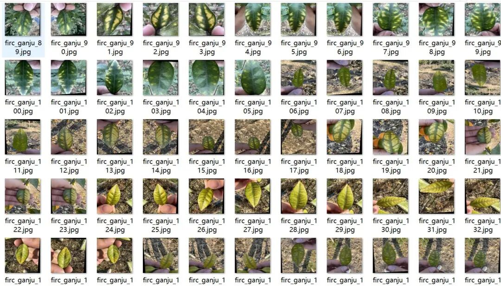
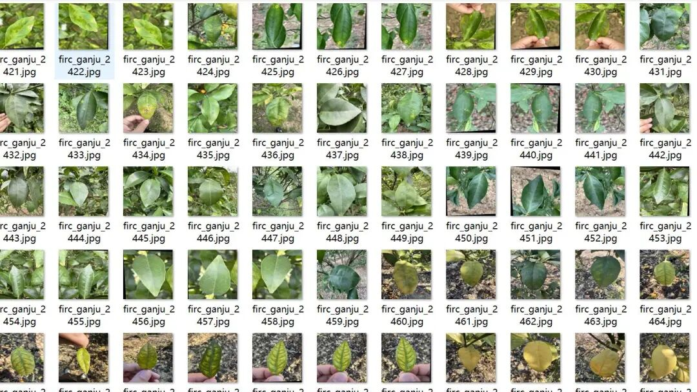
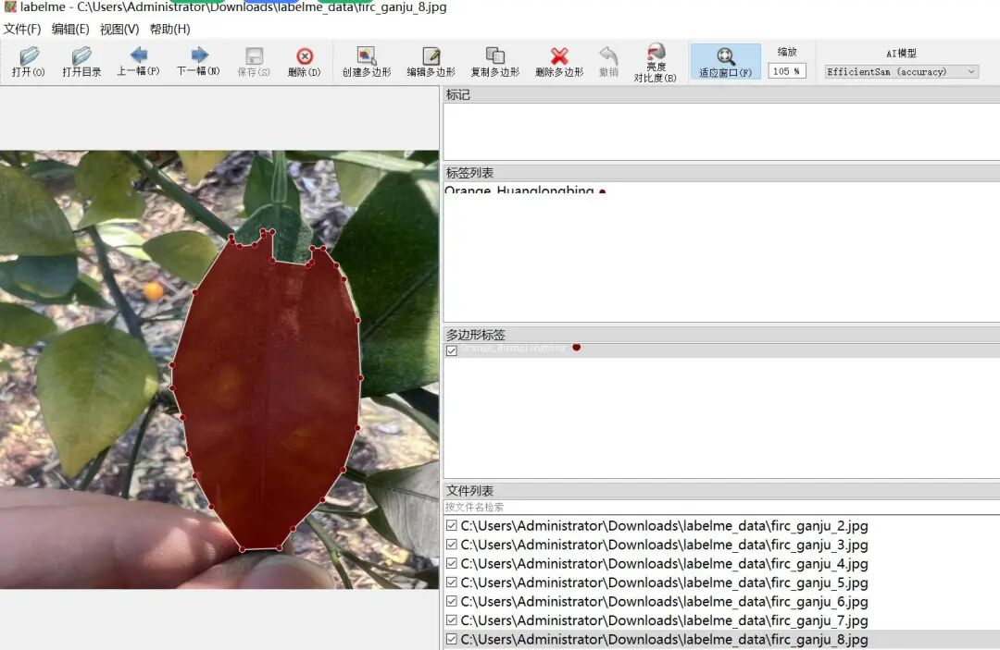
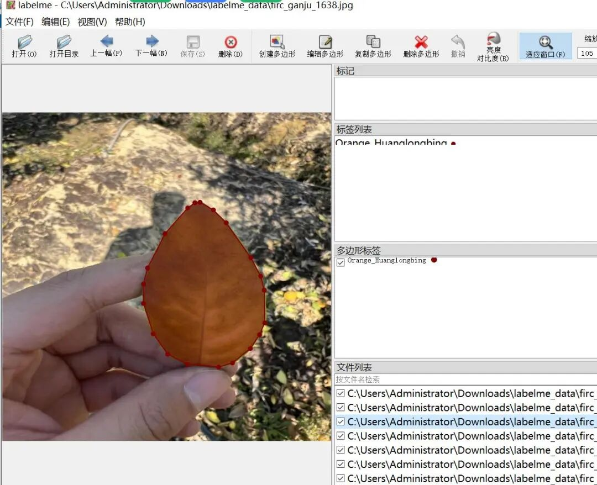

# Citrus Leaf Disease Identification and Segmentation Dataset in LabelMe format with 2476 images, 3 categories all featuring single leaves.

Dataset format: labelme format (without mask files, only including jpg images and corresponding json files)

Number of images (number of jpg files): 2476

Number of annotations (json file count): 2476

Label category count: 3

Label category names: ["Orange_Huanglongbing", "Orange_canker", "Orange_healthy"]

Number of boxes labeled in each category:

Orange_Huanglongbing (Yellow Dragon Blight) count = 2787

Orange_canker count (ulcers) = 1695

Orange_healthy (Healthy Leaves) count = 291

Using labeling tool: labelme=5.5.0

Image resolution: 640x640

Annotation rules: Draw polygons around the categories.

Important Notice: The dataset can be opened and edited using LabelMe. For JSON datasets, one must convert them into mask or Yolo formats for semantic segmentation or instance segmentation.

Special : This dataset does not guarantee the accuracy of the trained models or weight files.

Image Preview:

Annotation example:

## Payment

Here is a pay link on Stripe ( https://buy.stripe.com/3cs8yP7sY87d0vu9AB ). Please contact me lonlonago@foxmail.com after funding $89, and I will send you a complete data files , thank you!

